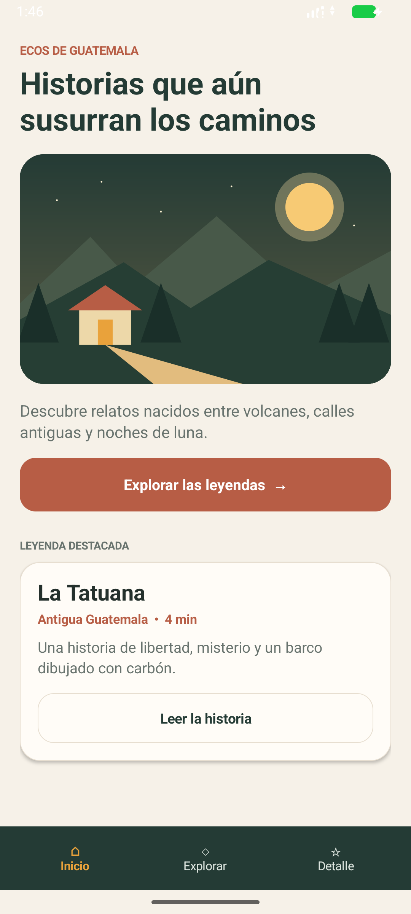
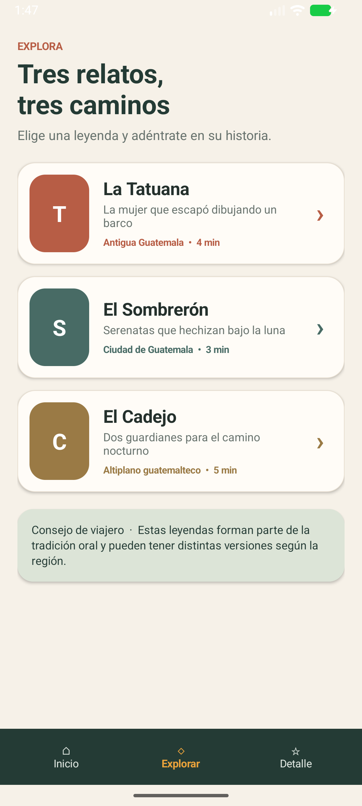
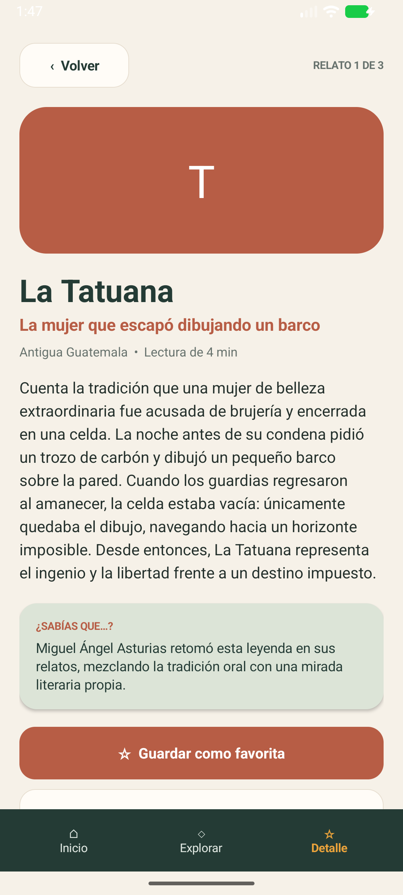

# Ecos de Guatemala — Práctica Android Studio

Aplicación Android desarrollada en **Kotlin** para descubrir leyendas guatemaltecas. El proyecto cumple con el requisito de una pantalla inicial y dos `Activity` adicionales, con navegación entre las tres.

## Temática

**Ecos de Guatemala** presenta tres relatos de la tradición oral: La Tatuana, El Sombrerón y El Cadejo. La interfaz utiliza una paleta inspirada en bosques, tierra y atardeceres, junto con una ilustración original dibujada directamente en Android.

## Pantallas

1. **Inicio (`MainActivity`)**: portada, ilustración, llamada a explorar y leyenda destacada.
2. **Explorar (`LegendsActivity`)**: catálogo interactivo con las tres leyendas.
3. **Detalle (`DetailActivity`)**: historia completa, curiosidad y acción para marcar favorita.

La barra inferior permite navegar entre las tres pantallas. También hay navegación contextual desde los botones y las tarjetas.

## Capturas reales del emulador

| Inicio | Explorar | Detalle |
|---|---|---|
|  |  |  |

Las capturas fueron tomadas después de instalar el APK `debug` en un emulador Android API 37 y recorrer la navegación de la aplicación.

## Tecnologías

- Kotlin
- Android SDK 37
- Gradle 9.6
- Android Gradle Plugin 9.4.1
- Interfaz con componentes nativos de Android (sin dependencias externas)
- Compatibilidad mínima: Android 7.0 (API 24)

## Cómo abrir y ejecutar

1. Clona o descarga este repositorio.
2. Abre **Android Studio**.
3. Selecciona **Open** y elige la carpeta `Practica_Android_Studio`.
4. Espera a que finalice la sincronización de Gradle.
5. Selecciona un emulador o dispositivo Android.
6. Presiona **Run ▶**.

También puedes compilar desde la terminal:

```bash
./gradlew assembleDebug
```

En Windows:

```powershell
.\gradlew.bat assembleDebug
```

El APK se genera en `app/build/outputs/apk/debug/app-debug.apk`.

## Estructura principal

```text
app/src/main/
├── AndroidManifest.xml
├── java/com/kazumjr/ecosdeguatemala/
│   ├── MainActivity.kt
│   ├── LegendsActivity.kt
│   ├── DetailActivity.kt
│   ├── data/Legend.kt
│   └── ui/
│       ├── HeroIllustrationView.kt
│       └── Ui.kt
└── res/
    ├── mipmap-anydpi/
    └── values/
```

## Repositorio de entrega

Repositorio indicado para la práctica:

<https://github.com/KazuMJR/Practica_Android_Studio>

Si el repositorio todavía está vacío, estos son los comandos para publicarlo:

```bash
git init
git add .
git commit -m "Proyecto Android: Ecos de Guatemala"
git branch -M main
git remote add origin https://github.com/KazuMJR/Practica_Android_Studio.git
git push -u origin main
```

## Autor

Práctica académica de Android Studio.
